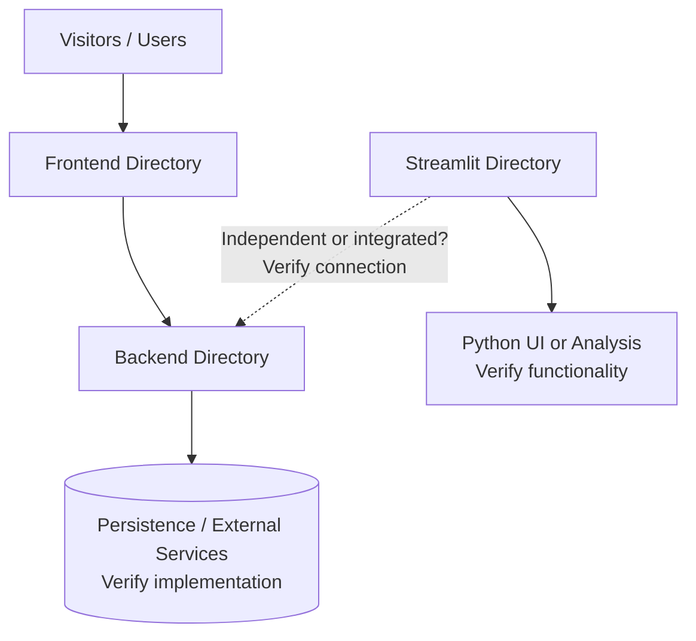

<div align="center">

# 🌱 FundForge

### A Crowdfunding Web Application

**A web-based project exploring how creators and supporters can connect around fundraising campaigns.**


</div>

> **Documentation note:** This README is based on the publicly visible repository root and GitHub's language breakdown. Individual source files were not reliably accessible during review. As a result, the architecture below is a *directory-level overview*, not proof of specific APIs, payment processors, authentication mechanisms, or working fundraising flows. Confirm and update the marked sections before publishing.

## 📖 Overview

FundForge is a portfolio-friendly name for the project in [`ishaa05/Crowdfunding_Website`](https://github.com/ishaa05/Crowdfunding_Website). The repository is organized into distinct frontend, backend, and Streamlit directories, suggesting a separation between the primary web interface, server-side logic, and a Python-based interactive component.

The broader goal of a crowdfunding platform is to help people present fundraising ideas and engage prospective supporters. The specific campaign, transaction, and dashboard features implemented in this repository should be documented once their source files are reviewed.

## 🧭 Repository at a glance

| Directory | Intended area | Verification status |
|---|---|---|
| `frontend/` | Web interface and UI assets | Directory confirmed; internal framework not verified |
| `backend/` | Server-side application code | Directory confirmed; API framework not verified |
| `streamlit/` | Python/Streamlit application or dashboard | Directory confirmed; execution and use case not verified |
| `node_modules/` | Installed JavaScript dependencies | Directory confirmed; should normally not be version-controlled |
| `README.md` | Repository documentation | Confirmed |

**Languages shown by GitHub:** JavaScript, CSS, HTML, Python, and TypeScript. These are repository-wide language indicators, not verified runtime dependencies.

## 🏗️ Architecture



The arrows depict a **conceptual layout** rather than a confirmed execution or data-flow trace. In particular, the relationship between the Streamlit component and the backend has not been established.

## ✨ Product experience to document

The following is a suggested checklist for documenting the application **if the corresponding features exist in the code**:

- [ ] Campaign discovery and filtering
- [ ] Campaign creation and management
- [ ] Funding targets and progress visualization
- [ ] Supporter contributions and payment workflow
- [ ] Authentication and account profiles
- [ ] Campaign updates and supporter engagement
- [ ] Interactive Streamlit dashboard or analysis

Check off only features that are implemented and working. A payment provider, blockchain integration, real-time analytics, and production security controls have **not** been verified.

## 🛠️ Technology

| Technology | Evidence | Role |
|---|---|---|
| JavaScript | GitHub language breakdown | Web application code |
| CSS / HTML | GitHub language breakdown | Styles and page markup |
| Python | GitHub language breakdown | Python code, including the `streamlit/` area |
| TypeScript | GitHub language breakdown | Typed application code, where used |
| Streamlit | Repository directory name | Likely interactive Python app; verify entry point |

> Do not add React, Node/Express, MongoDB, Stripe, Razorpay, or any other specific dependency here without confirming the project manifests and source files.

## 📂 Project structure

```text
Crowdfunding_Website/
├── backend/               # Server-side source (inspect entry point)
├── frontend/              # Website source (inspect build tooling)
├── streamlit/             # Python-side component (inspect entry point)
├── node_modules/          # Installed dependencies; usually excluded from Git
└── README.md              # Project documentation
```

## 🚀 Getting started

### 1. Clone the repository

```bash
git clone https://github.com/ishaa05/Crowdfunding_Website.git
cd Crowdfunding_Website
```

### 2. Inspect prerequisites

The start commands and precise package requirements could not be validated from publicly accessible source files. Locate the applicable manifests and entry points:

```bash
# macOS / Linux
find frontend backend streamlit -maxdepth 2 \
  \( -name 'package.json' -o -name 'requirements.txt' -o -name 'pyproject.toml' -o -name 'app.py' \)
```

For any directory that contains a `package.json`, inspect its `scripts` section:

```bash
cd frontend
cat package.json
# If appropriate, install dependencies using the lockfile's package manager,
# then run the exact script defined under "scripts".
```

Repeat for `backend/` if it has a separate Node-based manifest. For a Python application, create a virtual environment and install dependencies from the *actual* requirements file, if present.

### 3. Configure environment variables

Check the source for required environment variables and create local `.env` files **only where the application expects them**. Never commit credentials, database URLs containing passwords, private keys, or payment secrets.

### 4. Start the components

Start the application using the verified scripts or Python entry points. Record the frontend URL, backend port, and any Streamlit URL here after testing locally.

**Maintainer checklist before release:** document exact dependency versions, working start commands, required environment-variable names (not values), database initialization, and whether the Streamlit component is independent.

## 🖼️ Screenshots

Screenshots make a major difference for a visual portfolio. Add real images under `docs/screenshots/`, then uncomment these links after the image files exist:

```markdown
<!--  -->
<!--  -->
<!--  -->
<!--  -->
```

Suggested captures: landing page, campaign browsing, campaign details, creator workflow, and the Streamlit screen (if implemented).

## 🔐 Security and responsible operation

Any crowdfunding application handling real funds should validate server-side inputs, protect credentials, restrict access to account data, and confirm payments via trusted provider callbacks rather than relying solely on client-side status. These are **recommended requirements**, not claims that this repository already implements them.

**Do not use the project for real-money fundraising without an appropriate security and payments review.**

## 🧪 Testing

No test suite or CI configuration was independently verified. Add the commands for whichever tests actually exist and verify the key user flows manually or automatically.

## 🗺️ Roadmap ideas

- Improve setup and API documentation.
- Add reproducible automated tests and CI checks.
- Add deployment instructions and configuration templates.
- Introduce accessible, responsive pages and campaign visualizations where appropriate.
- Audit sensitive data handling and payment-related flows before any live deployment.

## 🤝 Contributing

Issues and pull requests are welcome. Describe the intended change, how to reproduce or test it, and attach screenshots for interface changes. Avoid committing `node_modules/`, generated artifacts, or secret configuration.

## 📄 License

A license was not verified from the repository root. Add a `LICENSE` file if you intend to specify reuse and contribution permissions.

---

<div align="center">

**FundForge — a foundation for building and documenting a crowdfunding experience.**

[View the source repository](https://github.com/ishaa05/Crowdfunding_Website)

</div>
